

<picture><source media="(prefers-color-scheme: dark)" srcset="assets/banner-dark.svg"></picture>

[Portfolio](https://kidus-yohannes.engineer/) ·
[X / Twitter](https://twitter.com/Kidusyoh) ·
[LinkedIn](https://www.linkedin.com/in/kidus-yohannes-568a31207) ·
[Medium](https://medium.com/@kidyoh789)

I'm co-founder of [MindBloom](https://mindbloom.kidus.engineer), an AI-driven
mental health platform. I started coding at Wollo University in 2020 and have been shipping
since: Flutter and Kotlin apps, React and Next.js sites, and the ML that sits
behind them. A lot of it is built for Ethiopia first.

## Featured

<a href="https://github.com/Kidyoh/Calendar">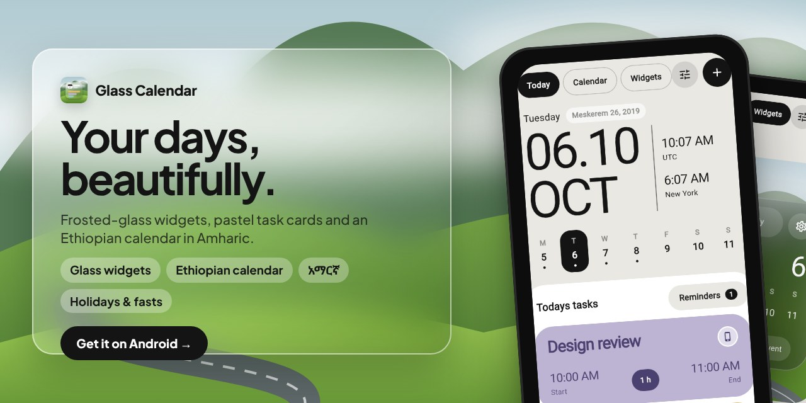</a>

**[Glass Calendar](https://github.com/Kidyoh/Calendar)** · Gregorian and
Ethiopian calendars in one app, in English and Amharic, with holidays, fasts,
reminders and home-screen widgets. *Flutter.*

<table>
  <tr>
    <td width="50%" valign="top">
      <a href="https://github.com/Kidyoh/Musicly">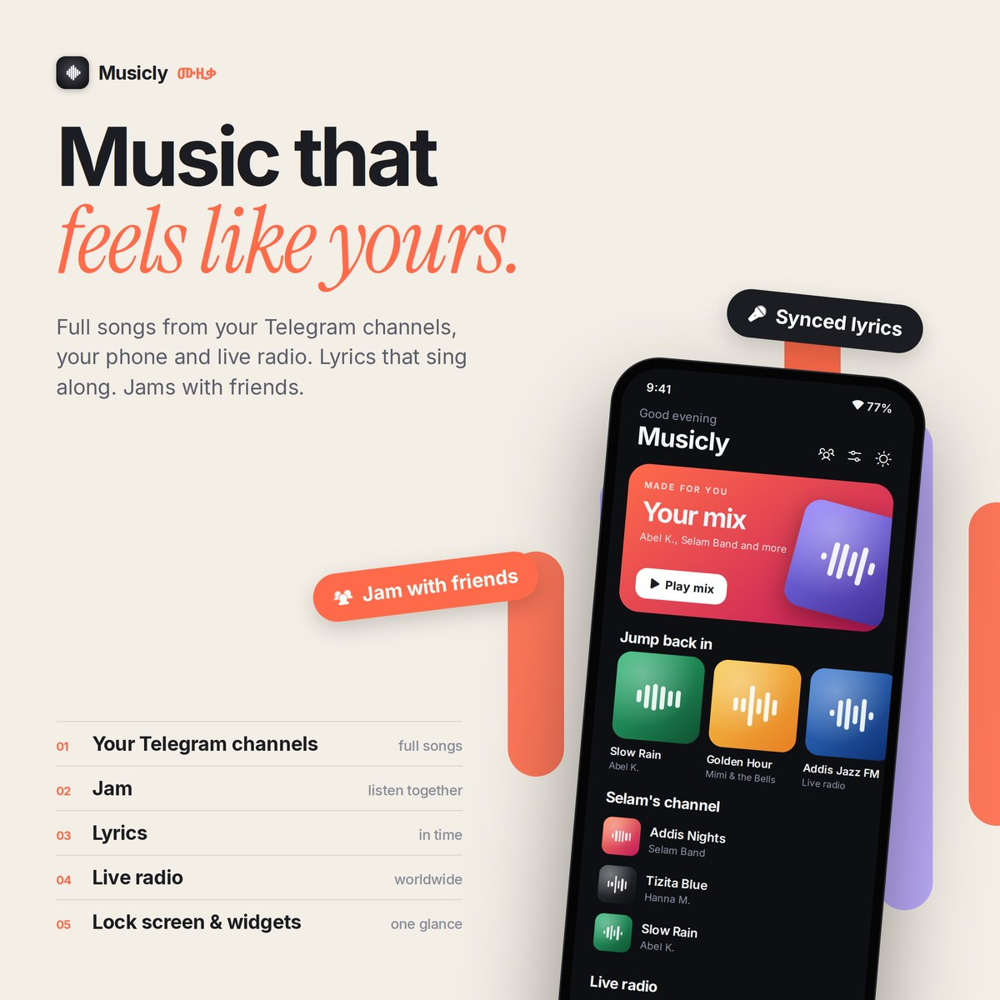</a>
        
      <b><a href="https://github.com/Kidyoh/Musicly">Musicly</a></b> · Plays songs from your Telegram channels, your phone, live radio and YouTube, with synced lyrics and listen-together Jams. <i>Flutter.</i>
    </td>
    <td width="50%" valign="top">
      <a href="https://github.com/Kidyoh/Screenshot-organizer">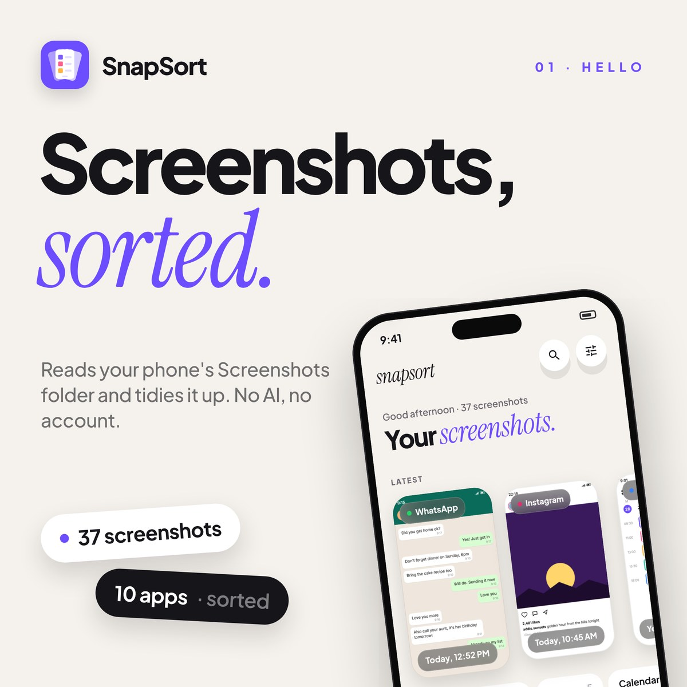</a>
        
      <b><a href="https://github.com/Kidyoh/Screenshot-organizer">SnapSort</a></b> · Sorts your Screenshots folder by app, album and date, fully offline, with swipe-to-clean and a duplicate finder. <i>Kotlin, Jetpack Compose.</i>
    </td>
  </tr>
</table>

## More things I've built

<table>
  <tr>
    <td width="50%"><a href="https://github.com/Kidyoh/Waterly"><picture><source media="(prefers-color-scheme: dark)" srcset="assets/apps/waterly-dark.svg">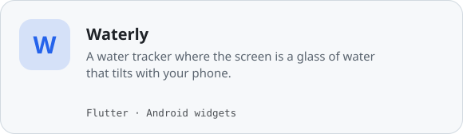</picture></a> <a href="https://github.com/Kidyoh/Waterly">Code</a></td>
    <td width="50%"><a href="https://dev-cards-eta.vercel.app"><picture><source media="(prefers-color-scheme: dark)" srcset="assets/apps/dev-cards-dark.svg">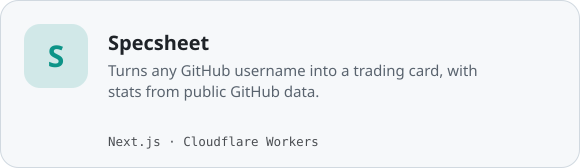</picture></a> <a href="https://dev-cards-eta.vercel.app">Live</a> · <a href="https://github.com/Kidyoh/Dev-cards">Code</a></td>
  </tr>
  <tr>
    <td width="50%"><a href="https://github.com/Kidyoh/rent-radar"><picture><source media="(prefers-color-scheme: dark)" srcset="assets/apps/rent-radar-dark.svg">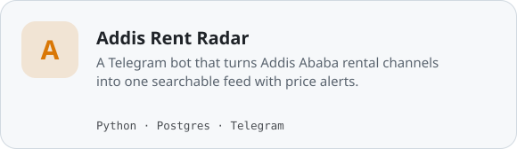</picture></a> <a href="https://github.com/Kidyoh/rent-radar">Code</a></td>
    <td width="50%"><a href="https://ml-road-map.vercel.app"><picture><source media="(prefers-color-scheme: dark)" srcset="assets/apps/ml-road-map-dark.svg">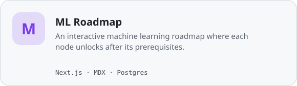</picture></a> <a href="https://ml-road-map.vercel.app">Live</a> · <a href="https://github.com/Kidyoh/ml-road-map">Code</a></td>
  </tr>
  <tr>
    <td width="50%"><a href="https://masinqo-sooty.vercel.app"><picture><source media="(prefers-color-scheme: dark)" srcset="assets/apps/masinqo-dark.svg">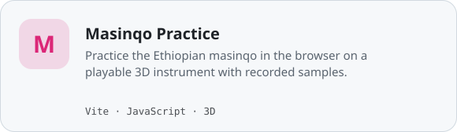</picture></a> <a href="https://masinqo-sooty.vercel.app">Live</a> · <a href="https://github.com/Kidyoh/Masinqo">Code</a></td>
    <td width="50%"><a href="https://ethio-earthquake.vercel.app"><picture><source media="(prefers-color-scheme: dark)" srcset="assets/apps/ethio-earthquake-tracker-dark.svg">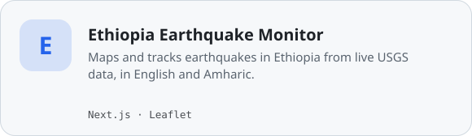</picture></a> <a href="https://ethio-earthquake.vercel.app">Live</a> · <a href="https://github.com/Kidyoh/ethio-earthquake-tracker">Code</a></td>
  </tr>
  <tr>
    <td width="50%"><a href="https://auditly.kidus-yohannes.engineer"><picture><source media="(prefers-color-scheme: dark)" srcset="assets/apps/auditly-dark.svg">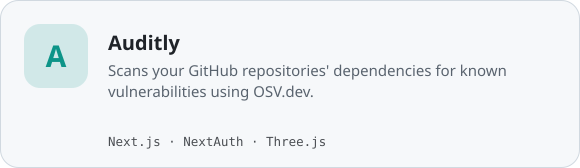</picture></a> <a href="https://auditly.kidus-yohannes.engineer">Live</a> · <a href="https://github.com/Kidyoh/auditly">Code</a></td>
    <td width="50%"><a href="https://github.com/Kidyoh?tab=repositories"><picture><source media="(prefers-color-scheme: dark)" srcset="assets/apps/more-dark.svg">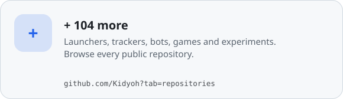</picture></a> <a href="https://github.com/Kidyoh?tab=repositories">All repositories</a></td>
  </tr>
</table>

## Commits, streaks and progress

<picture><source media="(prefers-color-scheme: dark)" srcset="assets/activity-dark.svg"></picture>

<picture><source media="(prefers-color-scheme: dark)" srcset="assets/progress-dark.svg"></picture>

<picture><source media="(prefers-color-scheme: dark)" srcset="assets/rhythm-dark.svg"></picture>

## The shape of it

<picture><source media="(prefers-color-scheme: dark)" srcset="assets/timeline-dark.svg"></picture>

<picture><source media="(prefers-color-scheme: dark)" srcset="assets/numbers-dark.svg"></picture>

Charts are drawn with D3 from my GitHub activity and refreshed every day.

## Say hello

I like talking about AI for local languages, mental health tech, and small
apps that feel good to use. The fastest way to reach me is
[X](https://twitter.com/Kidusyoh) or
[LinkedIn](https://www.linkedin.com/in/kidus-yohannes-568a31207).
