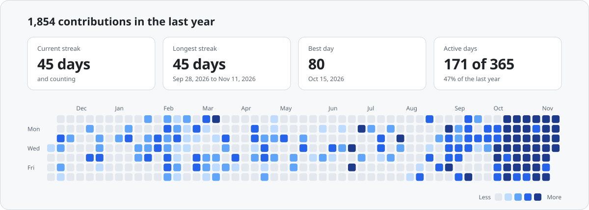
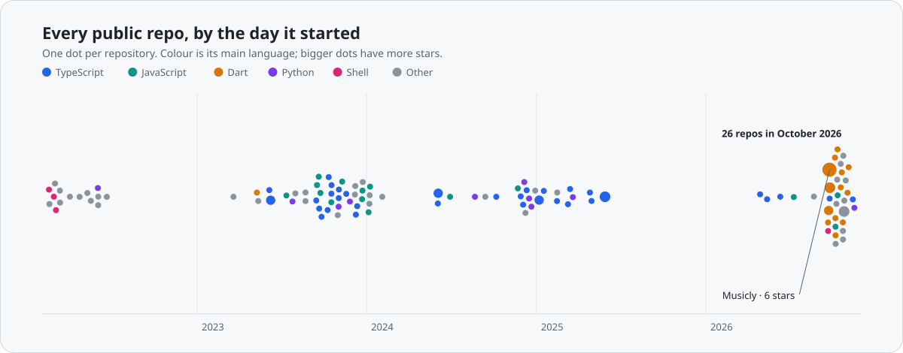

<picture><source media="(prefers-color-scheme: dark)" srcset="assets/banner-dark.svg"></picture>

[Portfolio](https://kidus-yohannes.engineer/) ·
[X / Twitter](https://twitter.com/Kidusyoh) ·
[LinkedIn](https://www.linkedin.com/in/kidus-yohannes-568a31207) ·
[Medium](https://medium.com/@kidyoh789)

I'm an ML engineer. I've been coding since 2020, and most of what I build
starts with a model: NLP and LLM systems, and the Flutter, Kotlin and Next.js
apps that put them in people's hands. A lot of it is built for Ethiopia first.

## Commits, streaks and progress

<picture><source media="(prefers-color-scheme: dark)" srcset="assets/activity-dark.svg"></picture>

<picture><source media="(prefers-color-scheme: dark)" srcset="assets/progress-dark.svg"></picture>

<picture><source media="(prefers-color-scheme: dark)" srcset="assets/rhythm-dark.svg"></picture>

## The shape of it

<picture><source media="(prefers-color-scheme: dark)" srcset="assets/timeline-dark.svg"></picture>

<picture><source media="(prefers-color-scheme: dark)" srcset="assets/numbers-dark.svg"></picture>

Charts are drawn with D3 from my GitHub activity and refreshed every day.

## Say hello

I like talking about machine learning, AI for local languages, and small apps
that feel good to use. The fastest way to reach me is
[X](https://twitter.com/Kidusyoh) or
[LinkedIn](https://www.linkedin.com/in/kidus-yohannes-568a31207).
